# IdleX — The Intelligent Resource Exchange
> *"Every idle resource has a purpose."*

[](https://nextjs.org/)
[](https://react.dev/)
[](https://tailwindcss.com/)
[](https://sqlite.org/)
[](https://github.com)

**IdleX** is an Awwwards-level intelligent resource-sharing and coordination platform engineered for high-consequence university laboratories, research facilities, and innovation parks.

---

## 1. Core Philosophy

The problem in research and innovation is rarely an absolute shortage of resources. Rather, it is the inability to **discover, access, and coordinate the resources that already exist**.

Multi-crore electron microscopes, industrial 3D printers, cleanrooms, and high-performance computing clusters remain dark after hours or between disconnected academic schedules—while researchers and innovators struggle with 12-week waitlists and budget constraints. IdleX turns underutilized physical equipment, research spaces, and digital compute into verified collaborative research capital.

---

## 2. Creative Direction: Anti-Slop Visual Identity

Engineered with an editorial, industrial-grade aesthetic:
- **Palette**: Deep graphite (`#07090C`, `#0D0F14`, `#12151B`), ink black, chalk white (`#F4F4F0`), and electric acid-lime accents (`#D4FF00`).
- **Typography**: Precision editorial hierarchy combined with micro-technical data labels (`font-mono tracking-widest text-[10px]`).
- **Surface**: Layered dark architectural surfaces, subtle fine borders (`border-white/10`), restrained depth, and zero generic purple AI gradient slop.
- **Microinteractions**: Interactive live delay simulators, real-time buffer telemetry, dynamic QR passport rendering, and responsive controls.

---

## 3. Signature Features

### 🛡️ Promise Protection™ (Disruption Management)
- **Turnaround Buffer**: Every asset enforces a mandatory 15–60 minute decontamination and recalibration window.
- **Cascading Collision Detection**: When an active session is delayed, the engine computes slack or deficit minutes against downstream reservations.
- **Autonomous Rerouting**: If an overrun breaches the buffer, the engine queries the database in real-time for zero-conflict equivalent assets and suggests an immediate reroute.
- **Interactive Simulator**: Judges can test delay overruns (+15m, +30m, +45m, +60m) directly on `/incidents` or the homepage, observe the collision detection, and click **Execute Automated Re-Route** to resolve the conflict in the real database.

### 🧠 IdleX Match™ (Natural Language Intent Engine)
- Users specify requirements in plain language: *"I need an industrial 3D printer for a carbon fiber prototype tomorrow with a budget under ₹400."*
- Analyzes intent, extracts budget caps, tests geographic proximity, checks real-time availability, and applies **hard SkillGate safety constraints**.
- Returns transparent compatibility scores (out of 100) with explainable rationale. An unverified applicant will never bypass safety gating regardless of semantic relevance.

### 🆔 Resource Passport™ (Cryptographic Identity & Custody History)
- Every physical resource possesses a persistent digital passport ID (`IXP-450MC-001`) and a scannable QR code resolving to its real application route.
- Authorised handover console with photographic evidence, checklists, and side-by-side inspection comparisons between checkout and return.
- Immutable maintenance logs, technician signatures, and incident records.

### ⚖️ FairShare™ (Explainable Allocation Protocol)
- Deterministic multi-variable scheduling when high-demand assets face slot contention.
- Prioritizes verified thesis defense milestones (+25), enforces departmental quotas, applies anti-hoarding throttles (-10 per active booking), and automatically promotes waitlist position #1 upon slot clearance.

### 🔒 SkillGate™ (Verified Eligibility & Safety Prerequisites)
- Server-side access gatekeeper. Laboratory equipment requiring laser certification, FDM industrial clearance, or ISO cleanroom gowning protocols permanently blocks unauthorized reservations at the transaction level.

### 📊 Idle Insights™ (Owner Analytics & Telemetry)
- Comprehensive operations dashboard for lab directors and equipment custodians.
- Real-time metrics: Overall utilization %, revenue/cost recovery, idle capacity captured vs lost, 7-day hourly demand timeline, and granular asset performance breakdown.

---

## 4. System Architecture & Relational Schema

```mermaid
flowchart TD
    subgraph UI ["Client Layer (Next.js 16 + Tailwind CSS + Lucide)"]
        Hero["Cinematic Landing (/)"]
        Explore["Directory & Filters (/explore)"]
        Passport["Resource Detail & QR Passport (/resources/[id])"]
        MatchUI["IdleX Match Intent Engine (/match)"]
        SimUI["Promise Protection Simulator (/incidents)"]
        DashUI["Role-Aware Mission Control (/dashboard)"]
        OwnerUI["Inventory & Requests Queue (/owner/*)"]
        InsightsUI["Idle Insights Telemetry (/owner/analytics)"]
    end

    subgraph Server ["Application Domain Layer (Node.js 26)"]
        AuthEng["Auth & Session Switcher (/api/auth/current)"]
        BookingEng["Atomic Booking Engine (/api/bookings)"]
        PromiseEng["Promise Protection Cascading Engine"]
        MatchEng["IdleX Match Semantic & Constraint Engine"]
        SkillEng["SkillGate Verification Engine (/api/admin/skills)"]
        FairEng["FairShare Queue Allocator (/api/fairshare/waitlist)"]
    end

    subgraph Storage ["ACID Database (Better-SQLite3 WAL Mode)"]
        DB[(data/idlex.db)]
        T1["users & user_skills"]
        T2["resources & resource_skills"]
        T3["bookings (Atomic Lock)"]
        T4["disruptions & incidents"]
        T5["condition_reports & maintenance"]
        T6["waitlist & audit_events"]
    end

    UI --> Server
    Server --> Storage
```



### Database Tables:
- `users`: ID, email, name, role (`user` | `owner` | `admin`), department, institution, avatar.
- `skills`: Safety and operational certifications (e.g. *Stratasys FDM*, *Laser Safety Level 2*, *Cleanroom Class 1000*).
- `user_skills`: User qualification records with verification status (`verified` | `pending` | `rejected`).
- `resources`: Asset specs, turnaround buffer (mins), hourly rate, deposit, condition rating, serial number, passport ID.
- `bookings`: Atomic reservation records with start/end time, return deadlines, delay minutes, and state machine (`confirmed`, `in_progress`, `delayed`, `returned`, `cancelled`).
- `disruptions`: Promise Protection incident records, risk level (`critical` | `moderate` | `nominal`), alternative suggestions, resolution actions.
- `condition_reports`: Checkout vs return inspection checklists, photos, and discrepancy notes.
- `waitlist`: FairShare queue records with calculated priority scores.
- `audit_events`: Immutable audit trail tracking every reservation, status transition, and administrative decision.

---

## 5. Evaluation Guide: 7 Core User Journeys

For hackathon judges and evaluators, the app includes a top **Judge Evaluation Sandbox Banner** with a 1-click persona switcher and a **Reset Demo** button.

### Journey A: Discover & Reserve an Available Asset
1. Set persona to **Dev Patel (Student Researcher)** in the top bar.
2. Navigate to **Explore** (`/explore`), filter by *Physical Equipment*, and select **Markforged X7**.
3. Choose a duration and click **Confirm Reservation**.
4. The server validates ACID locks, checks SkillGate certification, and confirms the reservation immediately.

### Journey B: Prevent Double Bookings (Atomic Concurrency)
1. Navigate to **Stratasys Fortus 450mc** (`/resources/res-stratasys-450mc`).
2. Attempt to book an overlapping slot matching Anya Sharma's confirmed session (1 hour from now).
3. The server rejects the overlapping reservation and provides an explainable conflict message with a prompt to join the **FairShare Waitlist**.

### Journey C: SkillGate Safety Restriction
1. Switch persona to **Kabir Mehta** (Unverified student).
2. Attempt to book the **Stratasys Fortus 450mc** (which mandates *Stratasys FDM Industrial Operator*).
3. The server immediately blocks the request: *"SkillGate Block: You have not verified the mandatory qualification"*.

### Journey D: Promise Protection Disruption Simulation & Rerouting
1. Navigate to **Promise Protection** (`/incidents`) or the homepage.
2. On the interactive simulator for the active Stratasys session, select **+45 mins Overrun** and click **Simulate Disruption in Real DB**.
3. Observe the immediate calculation: buffer breach, deficit of -15m, downstream collision warning for Anya Sharma, and autonomous recommendation of **Markforged X7**.
4. Click **Execute Automated Re-Route**: Anya's booking is re-routed in the database, eliminating the conflict with zero downtime.

### Journey E: Physical Handover & Condition Reporting
1. Navigate to **Bookings** (`/bookings`) and click **Manage Lifecycle** on an active booking.
2. Complete the verified checklist and submit the inspection. The condition rating and notes are immutably archived into the **Resource Passport**.

### Journey F: Custodial Review & Owner Requests
1. Switch persona to **Dr. Aris Vance (Resource Owner)**.
2. Navigate to **Requests** (`/owner/requests`) to review incoming reservation requests.
3. Approve or reject with recorded reasoning and audit tracking.

### Journey G: Administrative Oversight & Audit Trail
1. Switch persona to **Dean S. Raman (Administrator)**.
2. Open **Admin** (`/admin`) to verify pending student lab credentials and inspect the real-time system-wide audit event stream.

---

## 6. Quick Start & Setup

### Prerequisites
- Node.js (v20+ recommended)
- npm or pnpm

### Installation
```bash
# Clone and enter directory
cd codehack

# Install dependencies
npm install

# Seed demonstration database (Creates data/idlex.db with realistic research records)
npm run seed

# Run automated test suite (Tests concurrency, SkillGate, FairShare, Promise Protection)
npm test

# Build production application
npm run build

# Start local server
npm run start
```
Open **[http://localhost:3000](http://localhost:3000)** in your browser.

---

## 7. Test Suite Verification

Run the automated test suite verifying all core business logic:
```bash
npm test
```
**Test Results:**
```
✔ 1. Concurrency & Double Booking Overlap Prevention
✔ 2. SkillGate Eligibility Restriction Enforcement
✔ 3. Successful Booking with Verified Credentials
✔ 4. Promise Protection Disruption Simulation & Alternative Suggestion
✔ 6. FairShare Allocation & Waitlist Queuing
✔ 7. IdleX Match Natural Language Engine

tests 7 | pass 7 | fail 0 (Duration: ~38ms)
```

---

## 8. Built With
- **Framework**: Next.js 16 (App Router, Turbopack, React 19)
- **Styling**: Tailwind CSS v4 with custom design tokens
- **Database**: SQLite with `better-sqlite3` in WAL Mode (ACID Compliant)
- **Icons & Motion**: Lucide React, Framer Motion
- **Identities**: QR Code generator, persistent passport serial tracking

---
*IdleX — Engineered for National Research & Innovation Hackathons.*
